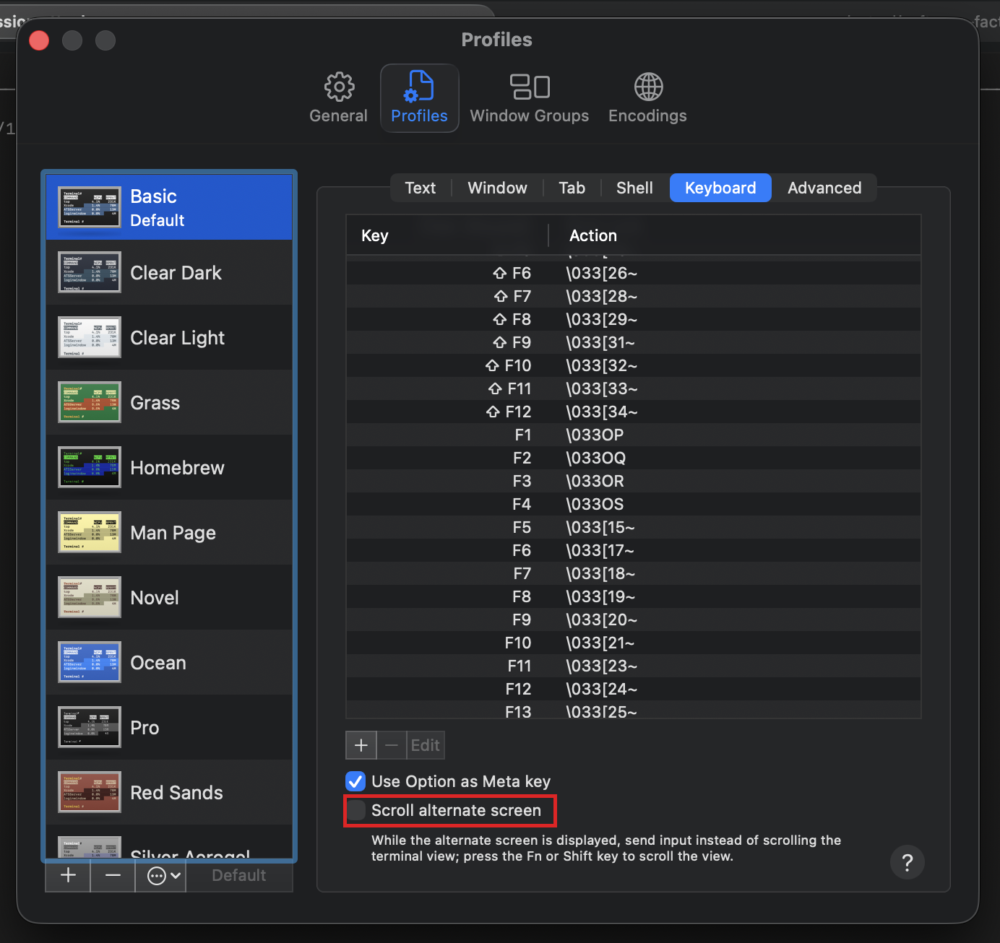

# Troubleshooting Guide

This guide provides solutions to common issues you may encounter while working through the Software Factory Intensive curriculum.

## General Issues

### Issue: Scrolling in a `tmux` session acts as mousekey input on the prompt history.

`tmux` (and other full-screen terminal apps like `vim` and `less`) uses the terminal's *alternate screen buffer*. By default, macOS Terminal treats scroll-wheel events inside alternate-screen apps as arrow-key input and forwards them to the running program — which is what makes scrolling inside a `tmux` session feel like it's walking through your shell's prompt history instead of moving the view. Enabling the **Scroll alternate screen** preference inverts the behavior so the scroll wheel scrolls the terminal view, and Fn/Shift+scroll sends input to the alternate-screen app.

**Fix (macOS Terminal):**

1. Open **Terminal** (macOS built-in).
2. Open **Terminal → Settings…** (or press **⌘,**).
3. Select the **Profiles** tab.
4. In the left sidebar, pick your profile (usually the highlighted/default one).
5. In the right pane, select the **Keyboard** sub-tab.
6. Near the bottom, check the **Scroll alternate screen** checkbox (highlighted in red above).
7. Close Settings. The change applies immediately in new `tmux` sessions; detach and reattach an existing session if it doesn't pick up the new behavior.

### Issue: The `gc` command doesn't seem to work.

There are several reasons this may be happening:

A. `gc` is not in your PATH.
  - Check if `which gc` returns a path. If not, add it to your PATH.
  - If `which gc` returns a path, check if the file exists. If not, install `gc` using the instructions in the [README](README.md).
  - If the file exists, check if it is executable. If not, make it executable using `chmod +x <path to gc>`.
  - If the file is executable, check if it is in your PATH. If not, add it to your PATH.
  - If the file is in your PATH, check if it is the correct version. If not, install the correct version using the instructions in the [README](README.md).

B. `gc` is not the correct version.
  - Check if `gc version` returns the correct version. If not, install the correct version using the instructions in the [README](README.md).

C. `gc` is aliased to something else (example: `git commit`).
  - Check if `alias gc='[command]'` is in your shell configuration. If so, unalias it.
